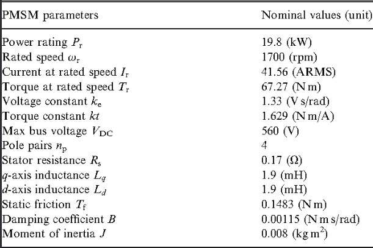
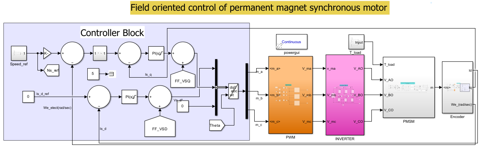
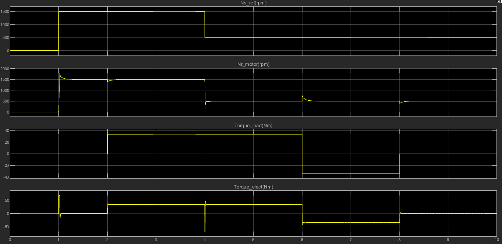
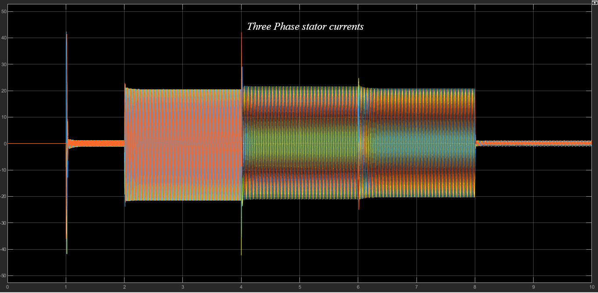
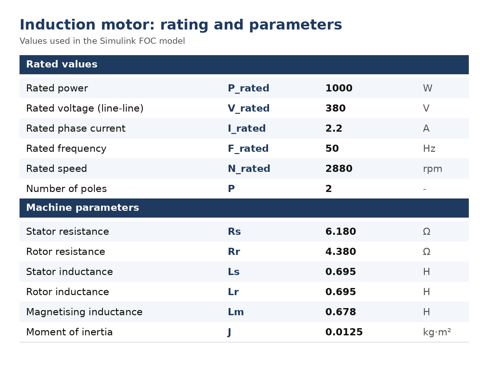
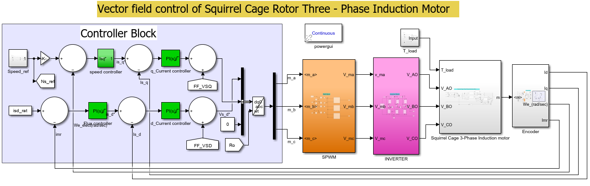
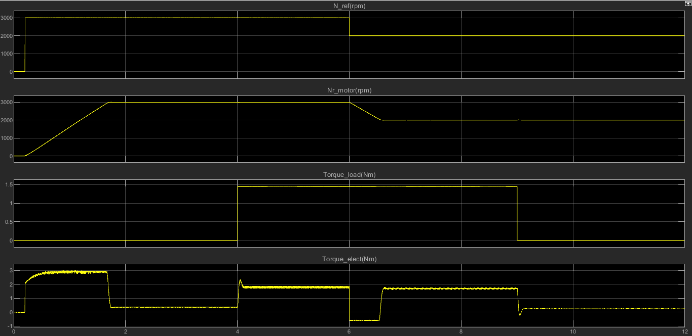
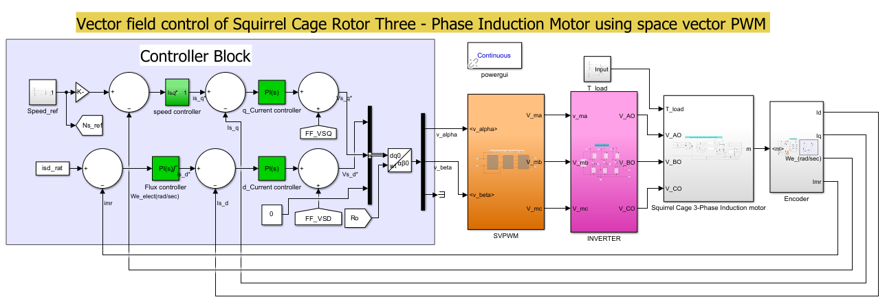
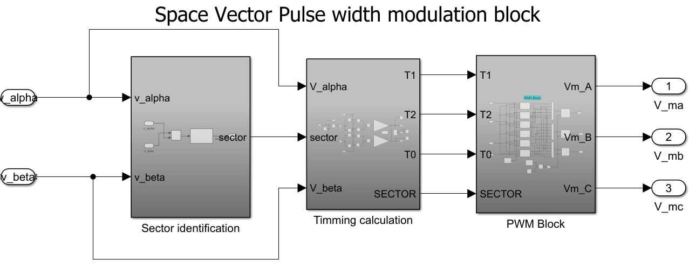
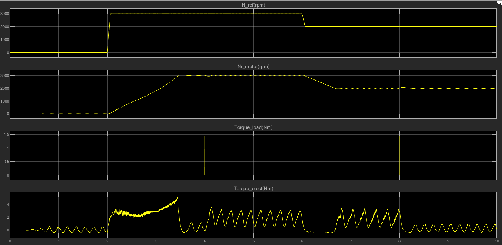

# Closed-Loop FOC of a PMSM and an Induction Motor (Simulink, MIL)

All three projects are Simulink simulations, with the controller and the motor model both running in simulation (model-in-the-loop). No hardware was used.

Common structure: Clarke-Park transforms, decoupled PI current loops (d and q axes), an outer PI speed loop, and an inverter model.

## 1. PMSM, 19.8 kW, 1700 rpm, SPWM

*PMSM rating (19.8 kW, 1700 rpm).*

*Simulink model of the PMSM FOC with an SPWM inverter.*

*Speed and torque response, including a load step.*

*Current response.*

Results: reference [value] rpm reached in [value] ms; load step of [value] Nm gives a speed dip of [value] % and recovery in [value] s; the drive tracks motoring and regenerative torque.

## 2. Induction motor, 2 HP, 3000 rpm, SPWM

*Induction motor rating (2 HP, 3000 rpm).*

*Simulink model of the induction motor FOC with an SPWM inverter.*

*Speed and torque response with SPWM, including a load step.*

Results: about 1.5 s rise time for a 0 to 3000 rpm reference step (torque-limited ramp); overshoot [value]; steady-state error [value]; load step of [value] Nm with a speed dip of [value].

## 3. Same induction motor, SVPWM

*Simulink model of the induction motor FOC with SVPWM.*

*Inside the SVPWM block.*

*Speed and torque response with SVPWM.*

Observed difference from the SPWM version: [write what you saw, or delete this line].

Contact: [LinkedIn](https://www.linkedin.com/in/shashwat-banerjee-7a7b43197) | shashwatbanerjee96iitd@gmail.com
