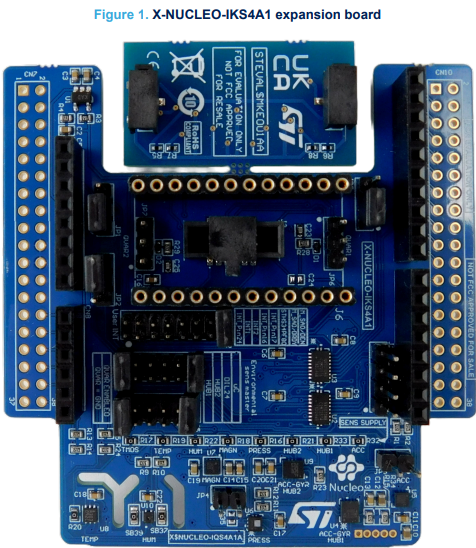
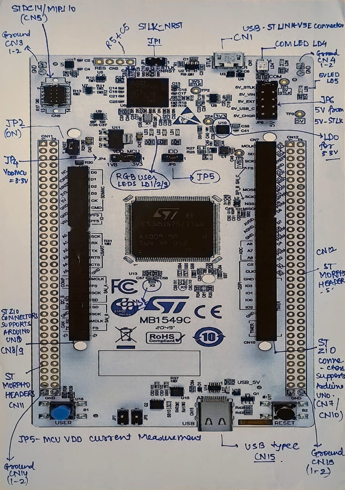
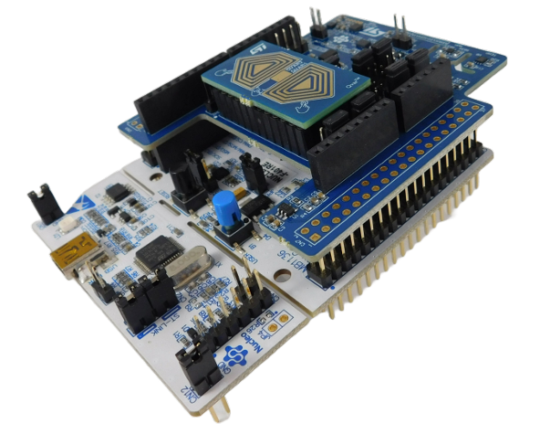
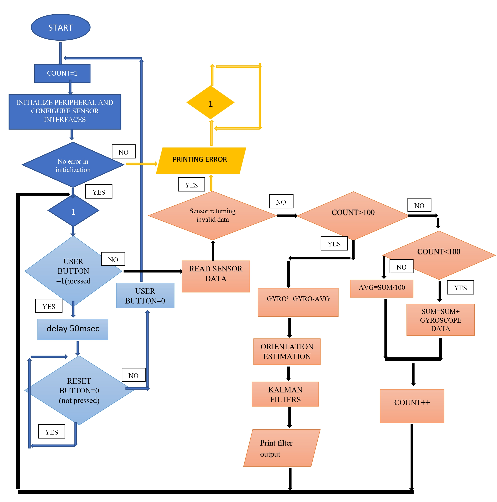
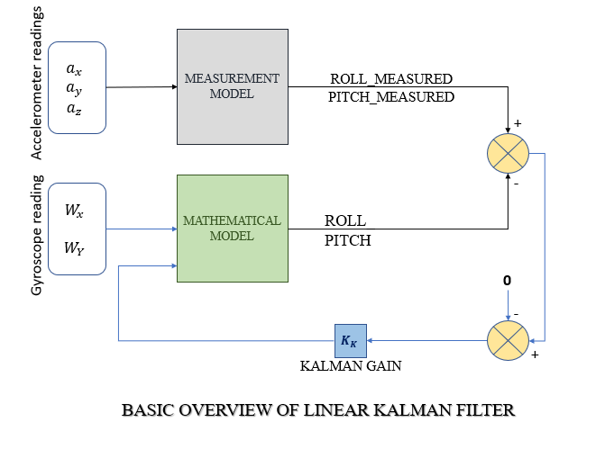
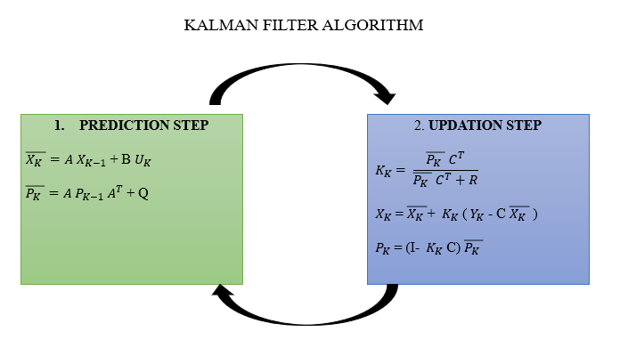
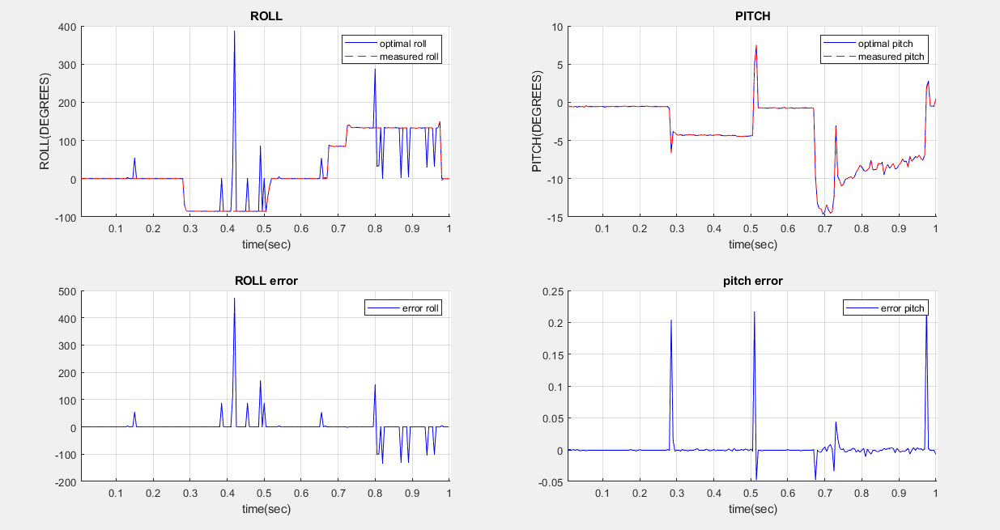

# Sensor Fusion for Orientation Estimation on STM32 (IMU, Kalman Filter)

ELD 850 minor project, M.Tech (Power Electronics, Machines & Drives), IIT Delhi.
Guided by Prof. Kaushik Saha and Prof. Anandarup Das.

## Context
The project's goal was a motion-based tamper-alert system for microcontroller-based converters. This repository covers the part that was completed: IMU data acquisition, calibration and Kalman-filter sensor fusion for roll and pitch. Tamper classification with machine learning is planned future work and is not part of what is shown here.

## Hardware
- **Microcontroller:** STM32U575ZI-Q (ARM Cortex-M33, floating-point support, 2 MB flash)
- **IMU board:** X-NUCLEO-IKS4A1, using the LSM6DSO16IS 3-axis accelerometer and 3-axis gyroscope
- **Tools:** STM32CubeMX (peripheral and clock setup), STM32CubeIDE (code, debugging), MATLAB (plotting)

*X-NUCLEO-IKS4A1 sensor expansion board.*

*STM32U575ZI-Q Nucleo development board.*

*The two boards assembled together.*

## Firmware
- Sensor initialization, data reading and UART output, starting from the ST sample project
- Sensor configuration: output data rate 105 Hz, accelerometer ±2 g, gyroscope ±250 dps (reduced from ±2000 dps to improve sensitivity to human-induced motion)
- Gyroscope bias calibration: the average of 100 samples at rest is subtracted from later readings

*Firmware flow: initialization, error checks, calibration over 100 samples, then orientation estimation and Kalman filtering.*

## Problem found and fixed
At rest the gyroscope returned large values. Cause: its 16-bit signed output was being stored in a 32-bit signed integer by the sample code. Fix: store the raw values as 16-bit signed integers and convert to degrees per second with the sensitivity for the selected range (8.75 mdps/LSB at ±250 dps). After this the readings at rest were close to zero.

## Kalman filter
A Kalman filter combines the gyroscope (precise in the short term but drifting) with the accelerometer (noisy but stable in the long term).

*Basic overview of the linear Kalman filter.*

*Linear Kalman filter algorithm: prediction step and update step.*

- State: roll and pitch (2 states)
- Prediction: gyroscope rates multiplied by the sample time, applied as the input
- Correction: roll and pitch from the accelerometer, used as the measurement
- Tuned values: initial P = 0.1·I, Q = 0.1·I, R = 0.001·I

## Results

*Estimated and measured roll and pitch (top) and the error between them (bottom), plotted in MATLAB.*

- **Pitch:** the filter output follows the measured pitch closely; the error stays near zero apart from brief spikes of about 0.2 degrees.
- **Roll:** the steady-state value is obtained, but there are large transient spikes (the error plot reaches several hundred degrees). [State what you believe causes them, for example angle wrap-around near ±180 degrees, or leave it as a known limitation.]
- The plotted error is the difference between the Kalman output and the accelerometer-derived angle, not against an independent reference.
- Next steps: retune Q and R for roll, then use the calibrated IMU data to train a tamper classifier.

Contact: [LinkedIn](https://www.linkedin.com/in/shashwat-banerjee-7a7b43197) | shashwatbanerjee96iitd@gmail.com
