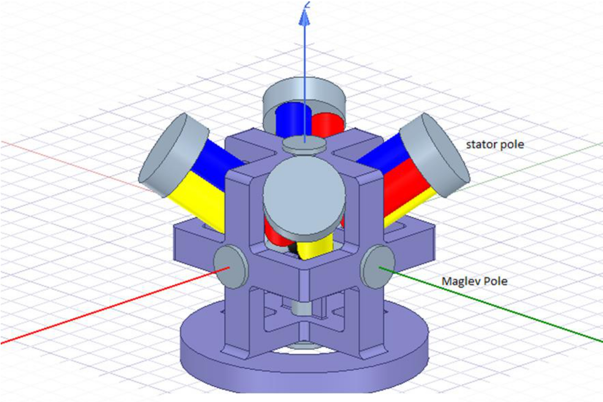
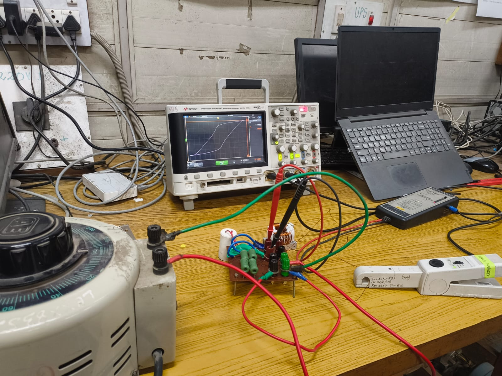
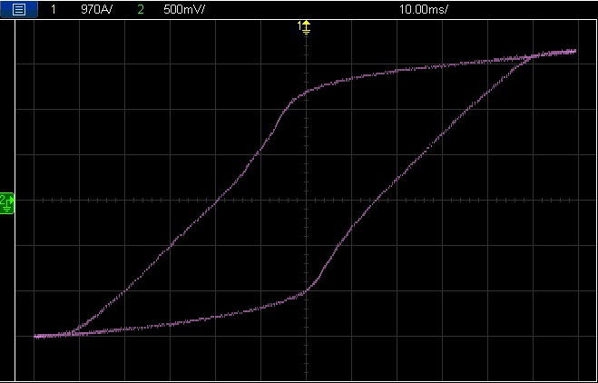
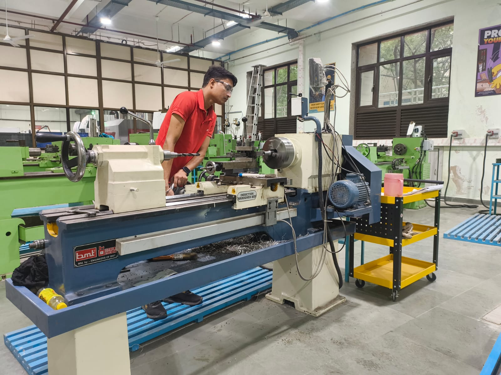
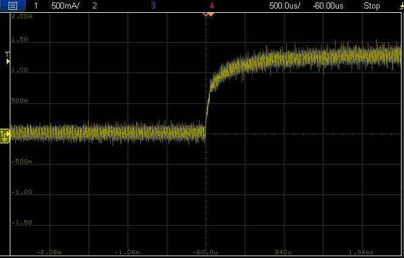

# M.Tech Thesis: Design and Control of Magnetically Levitated Spherical Motors for Space Applications

Guide: Prof. Krishan Kant Bhalla, IIT Delhi | Demo video: https://lnkd.in/p/dVbiqRVr

## 1. Design overview
Spherical rotor with 6 maglev poles (bearingless along all three global axes) and 4 sets of three-phase hysteresis motor windings, each rotating the rotor about its local axis.

*Final maglev and hysteresis motor assembly in ANSYS: 6 maglev poles, 4 hysteresis stator sets and the maglev body, showing the space optimization.*

## 2. B-H characterization of the rotor material (S52100 bearing steel)

*Laboratory rig used to measure the B-H loop.*

*B-H loop of S52100 traced on the DSO. This data was used for the rotor material properties in ANSYS Maxwell 3D.*

## 3. FEA: maglev (ANSYS Maxwell 3D)

*Maglev structure: cross section of the maglev poles and rotor along one axis.*

*ANSYS model of the vertical maglev setup.*

*Force versus circuit current.*

*Force versus rotor displacement.*

## 4. FEA: hysteresis motor

*Hysteresis motor stator and rotor along one axis.*

*Speed plot from ANSYS Maxwell.*

*Torque plot from ANSYS Maxwell.*

## 5. MIL simulation: maglev control
Parameters extracted from ANSYS were used in the Simulink model. Dual-loop controller: outer position loop, inner current loop.

*Dual-loop maglev controller in Simulink.*

*Position response (MIL).*

*Current response (MIL).*

## 6. MIL simulation: hysteresis motor

*Dual-loop Bang-Bang controller for the hysteresis motor in Simulink.*

*Speed response of the hysteresis motor with Bang-Bang control (MIL).*

## 7. Hardware and rapid control prototyping (vertical maglev)

*Machining of the maglev poles on a lathe (turning and drilling).*

*Close-up of the wound maglev poles and rotor.*

*Circuit diagram of the maglev operation.*

*Final hardware setup of the vertical maglev stabilization.*

*ADC-interrupt synchronization: the C28x Interrupt block (IRQ1) triggers the ADC-PWM function-call subsystem, so the control loop runs synchronized with ADC conversion.*

*Inside the ADC-PWM subsystem: position sensors via ADC feed the position controller, whose output is the reference for the PI current controller; the controller output sets the ePWM duty cycles.*

*Current response to a step change on hardware (DSO).*

## What ran where
| Part | Stage |
|---|---|
| Maxwell 3D design and B-H calibration | FEA simulation and bench measurement |
| Maglev controller | MIL, then code generation and RCP on hardware |
| Hysteresis motor Bang-Bang controller | MIL (simulation only) |

LinkedIn posts: [Maglev control](https://lnkd.in/p/gzrSWghU) | [Maxwell and B-H](https://lnkd.in/p/gDMaKcW5)
