# M.Tech Thesis: Design and Control of Magnetically Levitated Spherical Motors for Space Applications

Guide: Prof. Krishan Kant Bhalla, IIT Delhi | Demo video: https://lnkd.in/p/dVbiqRVr

## 1. Design overview
Spherical rotor with 6 maglev poles (bearingless along all three global axes) and 4 sets of three-phase hysteresis motor windings, each rotating the rotor about its local axis.

## 2. B-H characterization of the rotor material (S52100 bearing steel)

## 3. FEA: maglev (ANSYS Maxwell 3D)
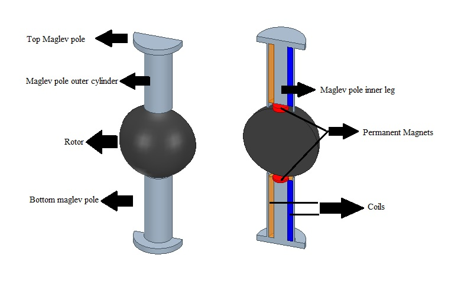
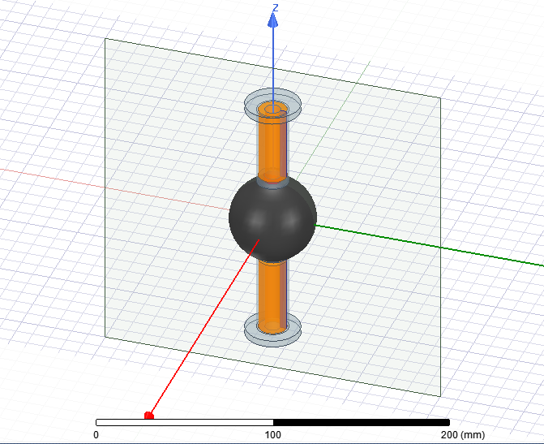
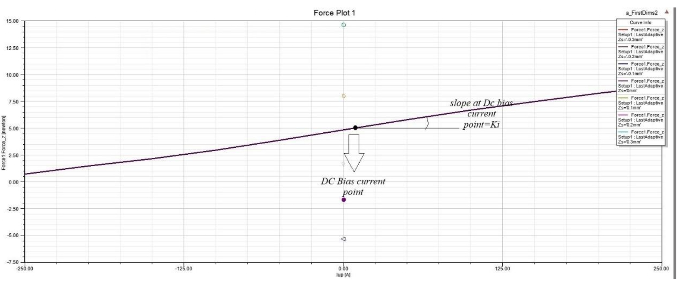
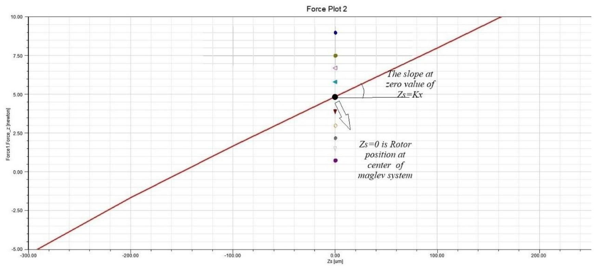

## 4. FEA: hysteresis motor
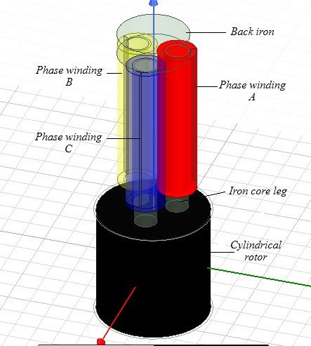
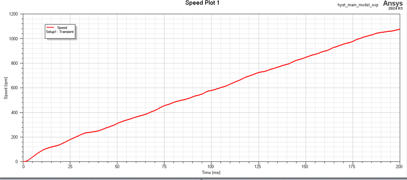
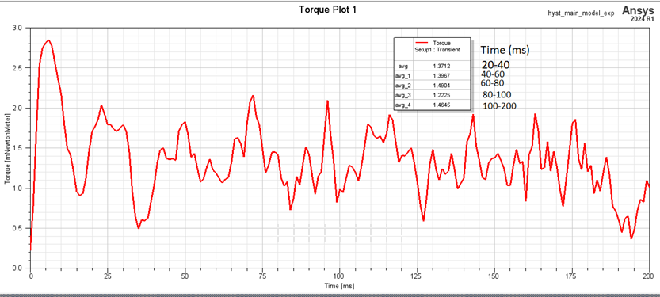

## 5. MIL simulation: maglev control
Parameters extracted from ANSYS were used in the Simulink model. Dual-loop controller: outer position loop, inner current loop.

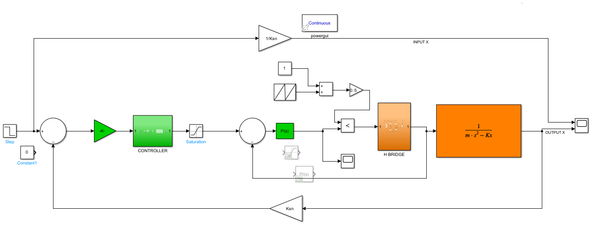
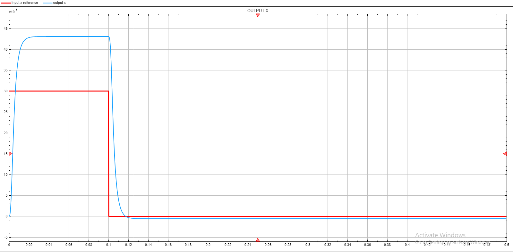
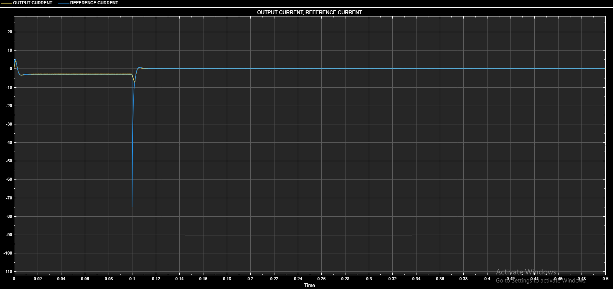

## 6. MIL simulation: hysteresis motor
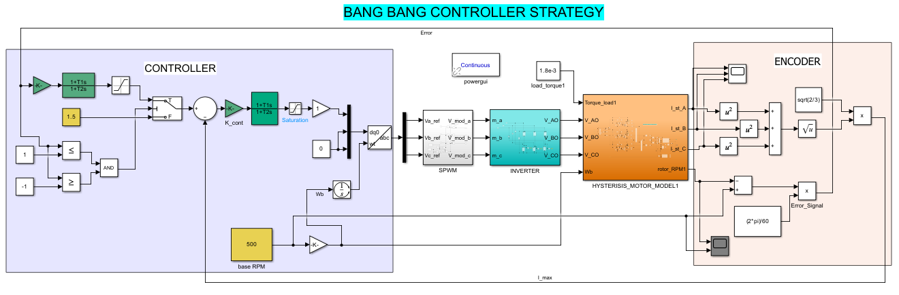
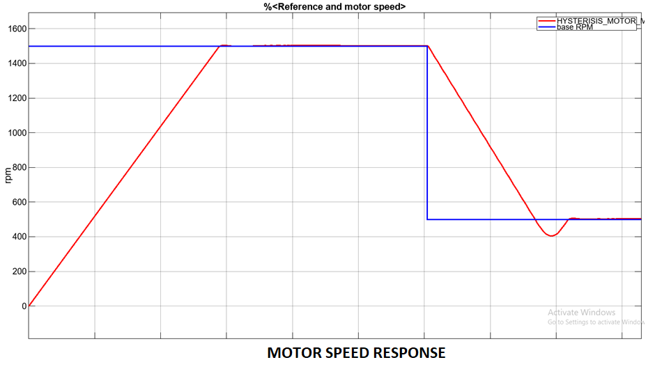

## 7. Hardware and rapid control prototyping (vertical maglev)

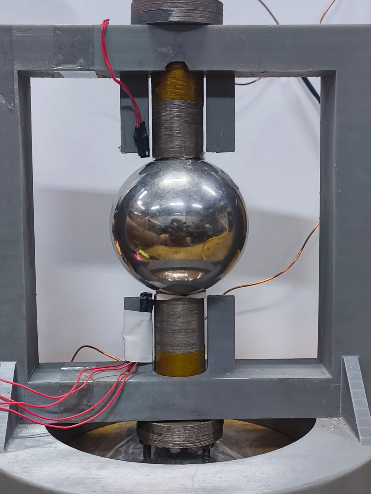
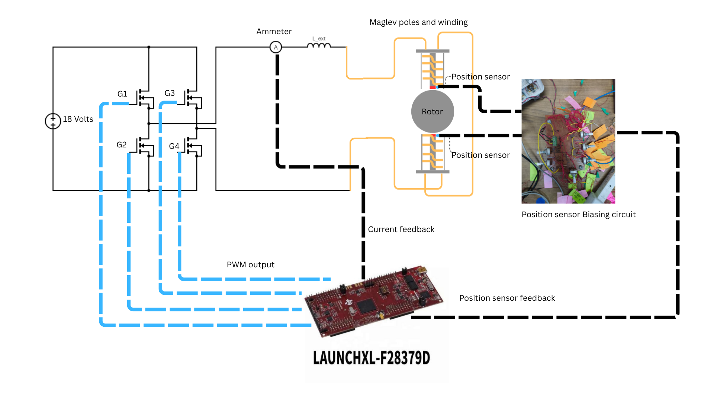
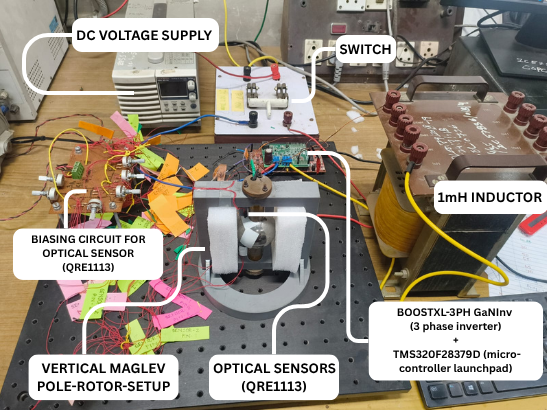
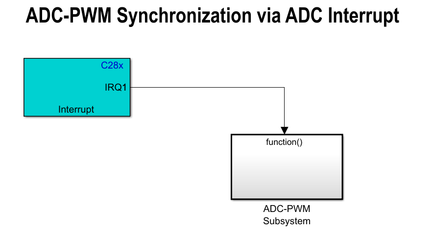
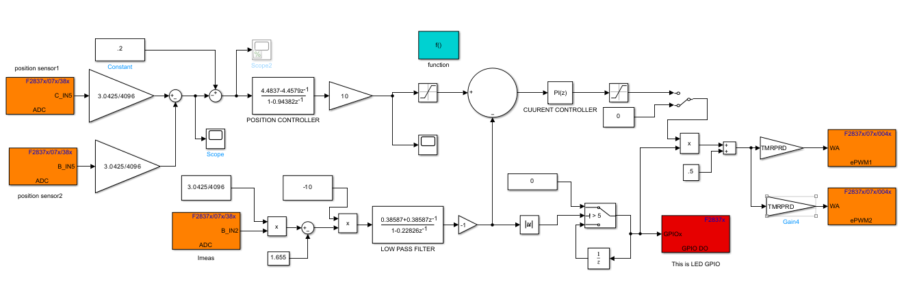

## What ran where
| Part | Stage |
|---|---|
| Maxwell 3D design and B-H calibration | FEA simulation and bench measurement |
| Maglev controller | MIL, then code generation and RCP on hardware |
| Hysteresis motor Bang-Bang controller | MIL (simulation only) |

LinkedIn posts: [Maglev control](https://lnkd.in/p/gzrSWghU) | [Maxwell and B-H](https://lnkd.in/p/gDMaKcW5)
